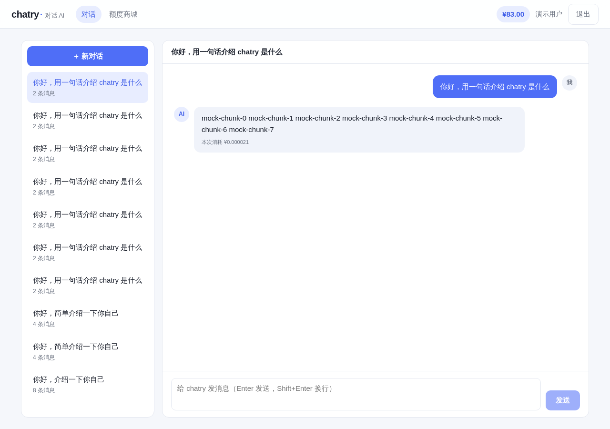
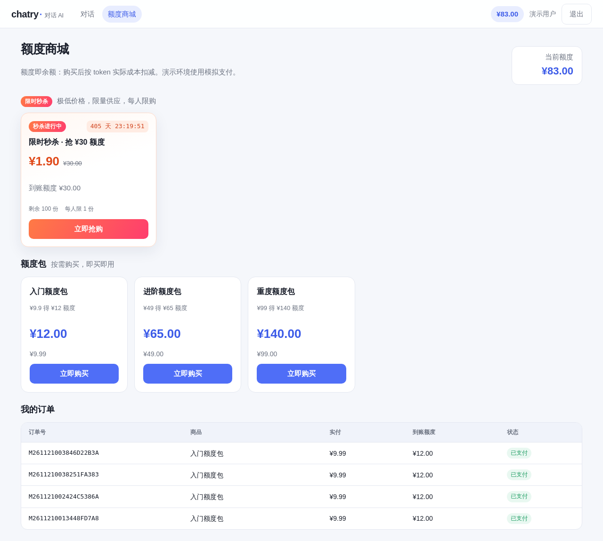
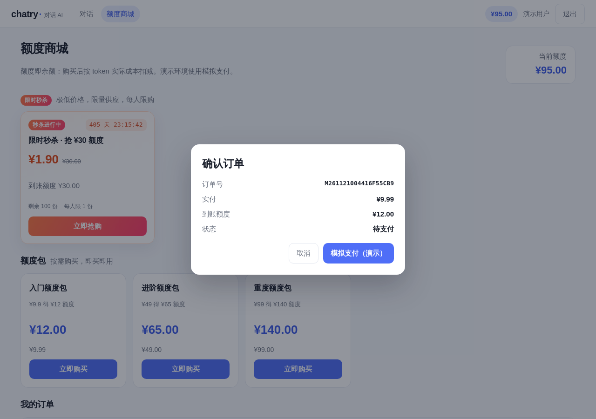
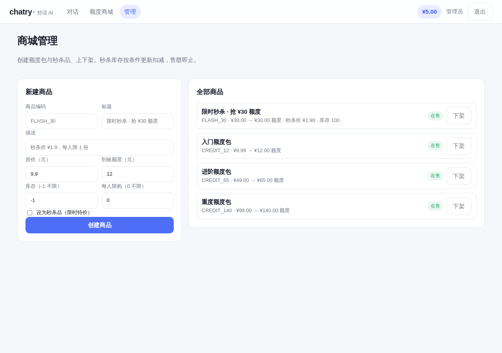
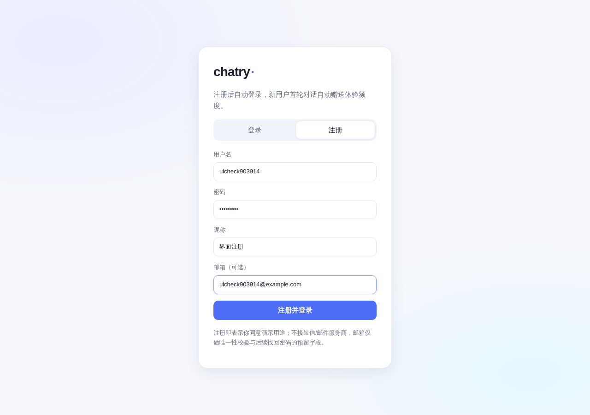
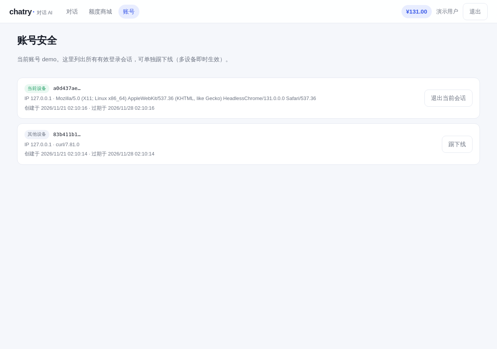
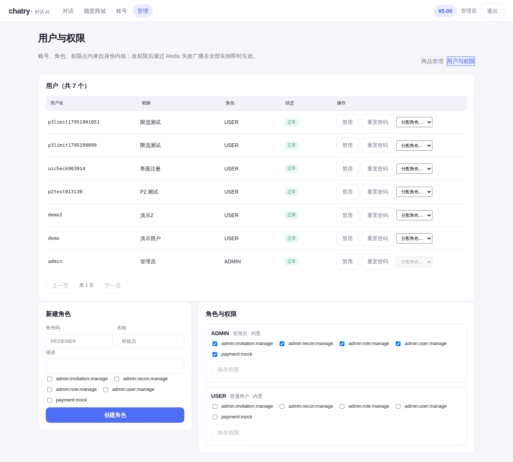
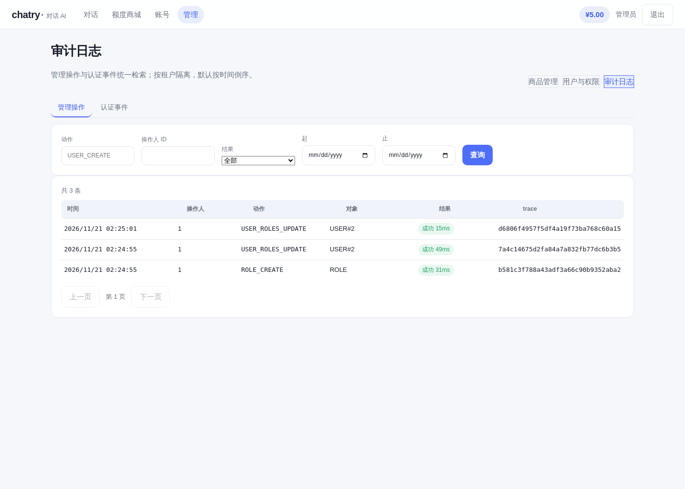

# chatry

**对话 AI + 额度商城 + 秒杀**：在 [atry](https://github.com/thereYany/atry) 内核之上构建的完整垂直产品（DeepSeek 网页版/豆包形态）。用户登录后多轮对话、流式输出，按 token 实时扣额度；额度在商城购买；管理员可发布限时秒杀（极低价换大额额度）。

前端 React + Vite，后端 Spring Boot，前后端同源部署在 8084 一个入口。

| 对话（流式 + 额度） | 额度商城（秒杀 / 额度包） |
|---|---|
|  |  |

| 下单与模拟支付 | 管理端（建品/秒杀/上下架） |
|---|---|
|  |  |

| 自助注册（用户名/密码/昵称/邮箱） | 会话列表 / 单会话踢下线 |
|---|---|
|  |  |

| 管理端：用户与权限（RBAC） | 管理端：审计日志检索 |
|---|---|
|  |  |

## 能力清单

| 模块 | 能力 |
|---|---|
| 对话 | 多轮上下文、SSE 流式输出（可停止）、Markdown 渲染、会话列表/重命名/删除、断连不计费 |
| 额度 | 额度 = atry 计量账户余额；按 token 实际成本预扣/结算；新手赠送；额度页估算可聊次数 |
| 商城 | 三档额度包；下单 → 支付（mock）→ 支付成功事件 → 幂等充值到账；订单列表；每人限购 |
| 秒杀 | 管理员配置限时秒杀品（低价/大额/限量/限购）；条件更新扣库存防超卖；未支付 15 分钟关单回补；并发压测脚本 |
| 充值安全 | Mock 支付只允许 dev/test + `provider=mock`；关闭/过期订单不可支付；关闭支付单回调不履约；重复支付幂等；`PAID_AFTER_CLOSE` 进入待处理 |
| 管理 | 商城：建品/秒杀/上下架；权限：用户列表、禁用/重置密码、分配角色、角色/权限创建与编辑；审计：管理操作/认证事件统一检索；ADMIN 接口鉴权 |
| 账号 | JWT 登录、**自助注册（用户名/密码/昵称/邮箱，无验证码）**、注册 IP 频控、认证审计、**会话列表/单会话踢下线**；demo/admin 演示账号 |

## 架构

```
web/                        React + Vite（登录 / 对话 / 商城 / 秒杀 / 管理）
   │ 同源 /api，SSE 走 fetch stream
   ▼
chatry-app                  宿主 + 垂直业务
 ├─ chat/                   会话、消息、多轮上下文、SSE 编排
 ├─ credits/                额度 = 计量余额（赠送/展示/成本口径）
 ├─ mall/                   SKU、订单、库存、秒杀、mock 支付、支付履约监听
 ├─ bootstrap/              管理员/演示账号种子
 └─ web/                    SPA 静态托管（classpath:/static）
        │ 只依赖 contracts
        ▼
atry 内核（atry-parent:0.1.0）
 atry-llm        超时/重试/熔断/限流/预算守卫/流式/调用记录
 atry-metering   预扣 → 结算/释放、不可变账本、定价、账单
 atry-payment    支付单状态机、mock/支付宝渠道、回调 + 查单兜底、发件箱
 atry-identity   JWT、RBAC、账号
 atry-platform   租户 SQL 拦截、AOP、告警、追踪
```

依赖方向：垂直域只依赖 `contracts`；支付成功通过 `PaymentSettledListener` 事件反转回业务，业务不反向调支付内部。

## 数据

- `t_chat_conversation` / `t_chat_message`（V900）：消息落库含 usage 与 `cost_micros`，与账本逐笔对得上
- `t_mall_sku` / `t_mall_order`（V901）：SKU 含秒杀字段；订单含 `limit_key` 唯一键（限购并发兜底）
- 内核表：`t_user`、`t_metering_*`、`t_payment_*`、`t_llm_call_record`
- 额度/账本不新建第二套：购买 = `t_metering_ledger` 的 RECHARGE（bizNo `mall:<orderNo>`），对话 = SETTLE

## 快速开始

前置：JDK 21、Maven、MySQL 8、Redis 7。

```bash
# 1) 数据库（一次）
sudo mysql -e "CREATE DATABASE IF NOT EXISTS chatry_dev CHARACTER SET utf8mb4;
CREATE USER IF NOT EXISTS 'chat'@'localhost' IDENTIFIED BY 'chatpass';
GRANT ALL PRIVILEGES ON chatry_dev.* TO 'chat'@'localhost'; FLUSH PRIVILEGES;"

# 2) 构建（前端产物已提交；改了前端先跑 scripts/build-web.sh）
mvn -B -DskipTests package

# 3) 启动（默认 mock 模型，不需要任何 key）
scripts/dev-run.sh

# 4) 冒烟：登录 → 额度 → 对话（余额下降）→ 流式
scripts/smoke.sh

# 5) 秒杀并发证据：20 并发抢 5 件库存，应恰好 5 单成功
scripts/flash-concurrency.sh
```

打开 **<https://118.31.111.223/chatry/>**（nginx 443 同源反代，证书为自签，与 DSH GUI 相同）；
本机也可直接访问 http://127.0.0.1:8084/ 。演示账号 `demo / demo123456`，管理员 `admin / admin12345`（演示环境关闭强制改密）。
反向代理配置见 [docs/deploy-nginx.md](docs/deploy-nginx.md)。

默认是 `mock-small` 假模型（固定回 `mock-chunk-0…7`，不产生费用）。接真实 DeepSeek：

```bash
scripts/dev-run-deepseek.sh   # 读 ~/.config/atry/deepseek.env 或 DEEPSEEK_API_KEY
```

每条回复按真实 token 计费（输入 ¥2/M、输出 ¥8/M），一条短回复约 ¥0.0002–0.0005。切回 mock：不带 `DEEPSEEK_ENABLED` 重启即可。

> ⚠️ 演示地址是公开的、demo 账密也写在页面提示里：接入真实 key 后，任何拿到地址的人都能消耗你的 DeepSeek 额度。对外分享前建议改 demo 密码或只在内测环境开真实模型。

## API

登录（内核）：`POST /api/auth/login`，之后所有接口带 `Authorization: Bearer <token>`。

| 方法 | 路径 | 说明 |
|---|---|---|
| GET | `/api/chat/credits` | 额度：余额/冻结/赠送/估算可聊次数 |
| GET/POST | `/api/chat/conversations` | 会话列表 / 新建 |
| GET/DELETE | `/api/chat/conversations/{id}` | 会话详情 / 软删除 |
| GET | `/api/chat/conversations/{id}/messages` | 历史消息 |
| POST | `/api/chat/conversations/{id}/messages` | 同步对话 |
| POST | `/api/chat/conversations/{id}/messages/stream` | SSE：`delta` / `done` / `error` |
| GET | `/api/mall/skus` | 在售额度包与秒杀品 |
| POST | `/api/mall/orders` | 下单（`{skuId}`），返回 orderNo/cashierUrl |
| POST | `/api/mall/orders/{orderNo}/mock-pay` | 模拟支付（演示渠道） |
| GET | `/api/mall/orders` | 我的订单 |
| GET | `/api/admin/mall/skus` | 全部商品（ADMIN） |
| GET | `/api/admin/users` | 用户分页（ADMIN，支持 keyword/role/status） |
| PUT | `/api/admin/users/{id}/status` | 禁用/启用 |
| PUT | `/api/admin/users/{id}/password` | 重置密码（踢下线） |
| PUT | `/api/admin/users/{id}/roles` | 分配角色 |
| GET | `/api/admin/roles` | 角色列表 |
| GET | `/api/admin/permissions` | 权限点列表 |
| POST | `/api/admin/roles` | 创建角色（含权限） |
| PUT | `/api/admin/roles/{code}/permissions` | 更新角色权限（多实例广播） |
| GET | `/api/admin/audit-logs` | 管理操作审计（动作/操作人/结果/日期/分页） |
| GET | `/api/admin/auth-events` | 认证事件检索（事件类型/用户名/结果/日期/分页） |
| POST | `/api/admin/mall/skus` | 建品/秒杀配置（ADMIN） |
| PUT | `/api/admin/mall/skus/{id}/status` | 上下架（ADMIN） |

## 秒杀设计（v1）

- **不超卖**：`UPDATE t_mall_sku SET stock = stock - 1 WHERE stock > 0`，影响行数为 0 即售罄。
- **限购**：限购 1 的订单写 `limit_key` 唯一键（`flash:<skuId>:<userId>`），并发重复下单由唯一键挡掉并回补库存。
- **不白占**：未支付订单 15 分钟后关单并回补库存（`MallOrderExpiryJob`）。
- **可放大**：单机 QPS 足够；真到抢购峰值再上 Redis 预扣 + 异步下单，逻辑边界已留好。

实测（本机 20 并发抢 5 件）：**5 成功 / 15 售罄，库存归零，无超卖**；数据库订单数 = 5。脚本 `scripts/flash-concurrency.sh` 可复现。

## 可观测性与错误契约（跟随 atry 0.7.0）

- 日志：`logback-spring.xml`（dev 文本 / prod JSON），每行带 traceId/userId/tenantId，消息脱敏；
  文件 `logs/chatry.log`、`logs/chatry-error.log`、`logs/chatry-access.log`
- 访问日志：`access method=... path=... status=... latencyMs=... userId=... tenantId=... slow=... traceId=...`；
  SSE 记录完整流时长；`LOG_ACCESS_ENABLED` / `ACCESS_LOG_SLOW_MS` 可调
- 错误体统一为 `code/message/traceId/path/timestamp/details`；LLM 错误码直接用内核分类
  （`QUOTA_EXHAUSTED` / `RATE_LIMITED` / `CANCELLED` ...），前端按 `code` 分支
- 慢 SQL：`SLOW_SQL_ENABLED=true SLOW_SQL_THRESHOLD_MS=200`（默认关）
- 审计保留：`t_auth_event` / `t_admin_audit_log` 默认保留 180 天，每天 03:20 分批清理（`AUDIT_RETENTION_DAYS`）
- 用户管理读路径走 MyBatis（账号分页），并受 `MybatisTenantGuard` 的显式 tenant_id 校验保护
- OpenAPI：本机 `http://127.0.0.1:8084/v3/api-docs`（公网 `/chatry/` 前缀下 Swagger UI 重定向不走前缀，以 JSON 为准）

## 测试

```bash
mvn -B test        # 28 个用例：上下文截断、取消落库、成本换算、秒杀扣减/售罄/限购/时间窗、订单归属、Mock 守卫、关闭单履约
```

## 已知限制

- 支付只有 mock 渠道（演示用）；真实支付宝需要商户资质与密钥，回调域名未接。
- 单租户（tenant_id=0）部署假设；多租户按 atry 既有结论暂不启用。
- 秒杀未做「热点商品 Redis 预扣 / 异步下单」；当前 DB 条件更新适合单机演示与中小流量。
- 额度无有效期/退款；「已生成即计费」未启用（断连按 CANCELLED 不计费）。
- 管理端只做了建品/上下架，用户/角色管理沿用内核对账接口，未做页面。
